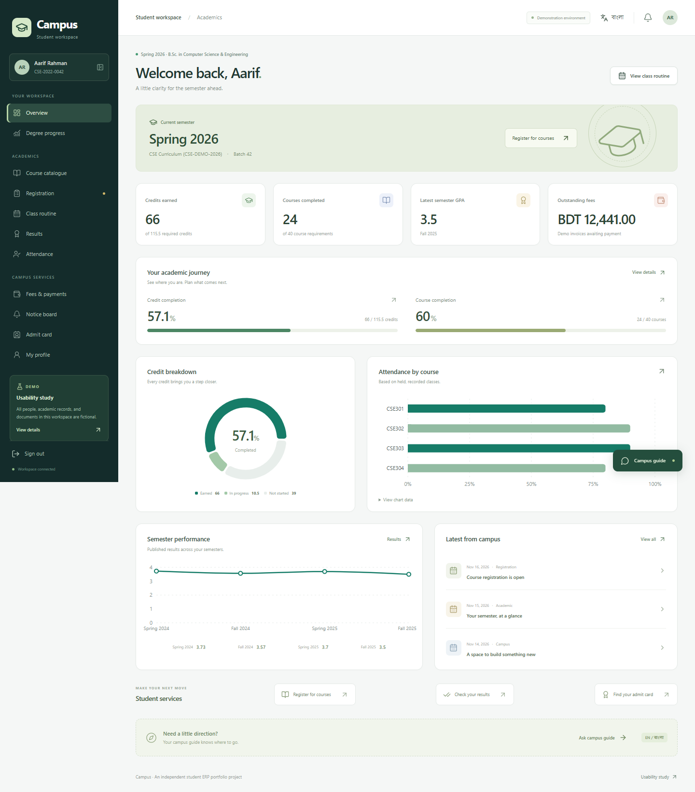

# Campus · Bilingual Student ERP

[](https://github.com/Shadman-Al-Muksit/campus-student-erp/actions/workflows/ci.yml)

A portfolio ERP for a fictional CSE program: an English/Bangla student portal, academic administration, interactive degree progress, and a small deterministic navigation helper.

**Local first release implemented and verified.** Uses PostgreSQL and a real session-authenticated API. The participant study is prepared but has not been conducted. Faculty/accounts roles and public hosting are later milestones.



[Bangla dashboard](docs/screenshots/dashboard-bn.png) · [Mobile dashboard](docs/screenshots/dashboard-mobile.png) · [Degree progress](docs/screenshots/degree-progress.png) · [Administration](docs/screenshots/administration.png)

[Academic sign-in page](docs/screenshots/login-en.png) · [Bangla sign-in page](docs/screenshots/login-bn.png)

## What works

- Student and administrator login/logout, profile, bilingual navigation, and expired-session recovery.
- Clickable course/credit completion, credit donut, attendance bars, GPA trends, and accessible detail tables.
- Assigned curriculum versions, elective slots, duplicate-attempt protection, and completed/in-progress/not-started requirements.
- Course offerings, registration requests, prerequisite/credit/deadline/clash checks, locked seat allocation, decisions, and approved routines.
- Published results and credit-weighted GPA with saved historical credit values.
- Attendance with cancelled, excused, and unmarked records handled separately.
- Demo invoices, partial payments, balances, printable records, notices, and sample admit cards.
- Administrator screens for approvals, offerings, publication, attendance, finances, notices, and audit history.
- A seven-topic English/Bangla helper with suggested questions, limited keywords, ambiguity choices, direct links, and unsupported-question fallback. No LLM or paid AI API.
- Basic/enhanced study views with separate fictional accounts and normal permission checks.

## Architecture

React + TypeScript + Vite → Django REST API → PostgreSQL.

The browser uses Django session cookies and CSRF protection. All permissions and academic calculations run on the server. Dashboard graphs and detail tables share the same calculation service.

| Part | Tools |
| --- | --- |
| Interface | React, TypeScript, Vite, React Router |
| Design and charts | Tailwind CSS, shadcn-style primitives, Recharts |
| Data and language | TanStack Query, i18next, react-i18next |
| Backend | Django 5.2 LTS, Django REST Framework, PostgreSQL |
| Verification | pytest-django, Playwright, Python unittest |
| Research analysis | pandas, Matplotlib; actual observations required |

The technical Django admin is read-only. Operational edits use audited application APIs rather than bypassing registration, publication, or payment rules.

## Project layout

- `frontend/` — React interface, bilingual strings, Recharts visualizations, guided help.
- `backend/` — Django models, API, administration, demo seed, and backend tests.
- `research/` — usability protocol, anonymized template, analysis code, and tests. No participant observations have been collected.
- `docs/` — API contract, design decisions, and beginner learning guide.
- `scripts/` — WSL setup, startup, PostgreSQL backup and safe restore.

## Local development

On this computer, open **Ubuntu WSL** and run:

```bash
cd /mnt/d/Shadman-Desktop/Career/student-erp
bash scripts/dev.sh
```

Open **[http://localhost:5173](http://localhost:5173)**. Keep the terminal open; **Ctrl+C** stops both app servers. Alternatively, run `Start-ERP.ps1` from PowerShell. To stop the project database too, run `bash scripts/stop-database.sh` after stopping the app.

### First installation on another machine

Tested on Ubuntu 24.04 x86_64, Python 3.12, Node 22, and PostgreSQL 16. Docker is not required.

```bash
git clone https://github.com/Shadman-Al-Muksit/campus-student-erp.git
cd campus-student-erp
sudo apt-get update
sudo apt-get install -y postgresql-16 python3 curl xz-utils
bash scripts/setup.sh
bash scripts/dev.sh
```

Setup installs locked Python dependencies and a checksum-verified Node 22 runtime. It creates a project-specific Python environment, PostgreSQL cluster, and ignored `.env` file. Database data lives outside the repository in `~/.local/share/campus-erp/pgdata` on **127.0.0.1:55432**. No existing PostgreSQL cluster is overwritten.

Existing records, passwords, and edits are preserved on repeat setup. Registration dates are relative to the first seed and do not silently move on later seeds. Use one checkout per runtime directory, or choose a distinct `CAMPUS_RUNTIME_ROOT`. Match the PostgreSQL version when reusing a data directory. If Ubuntu omits `ensurepip`, setup uses the official PyPA bootstrap source inside the isolated environment.

## Demonstration accounts

| Role | Username | Password |
| --- | --- | --- |
| Student | `student` | `CampusDemo!2026` |
| Second student | `student2` | `CampusDemo!2026` |
| Study profiles | `study_a`, `study_b` | `CampusDemo!2026` |
| Administrator | `admin` | `CampusAdmin!2026` |

These are intentionally public fictional demo accounts. Do not reuse their passwords for real accounts or expose an unmodified demo to real student records.

A fresh seed has four students, 44 catalogue courses, and 40 curriculum requirements. The main student initially has **66 / 115.5 credits (57.14%)**, **24 / 40 requirements (60%)**, and **CGPA 3.62**. Browser tests perform fictional financial operations, so balances and audit records change after testing.

## Understand and verify the project

- [Beginner learning guide](docs/LEARNING_GUIDE.md): follow a request from screen to database, understand permissions, calculations, and maintenance.
- [API contract](docs/API_CONTRACT.md): endpoints, data fields, and calculation conventions.
- [Verification record](docs/VERIFICATION.md): performed checks and their limits.
- [Research design](docs/RESEARCH_DESIGN.md) and [study materials](research/README.md).

Run backend checks, research tests, and the production build from Ubuntu:

```bash
bash scripts/check.sh
```

Browser tests need the app running in another terminal. Native Linux/WSL2 can install Chromium with `npx playwright install --with-deps chromium` in `frontend/`, then run `npm run test:e2e`. On **WSL1**, the verified local approach uses Windows Node 22+ and installed Edge against WSL app servers:

```powershell
cd D:\Shadman-Desktop\Career\student-erp\frontend
$env:PLAYWRIGHT_EXECUTABLE_PATH = 'C:\Program Files (x86)\Microsoft\Edge\Application\msedge.exe'
$env:BASE_URL = 'http://localhost:5173'
node node_modules/@playwright/test/cli.js test
node scripts/capture.mjs
```

GitHub Actions runs the complete suite with PostgreSQL and Linux Chromium. Run browser financial tests only against fictional demonstration data.

## Backup and recovery

```bash
bash scripts/backup.sh
bash scripts/restore.sh backups/your-backup.dump campus_restore_example
source scripts/env.sh
python scripts/verify_restore.py campus_restore_example
```

Restore requires a new database name beginning `campus_restore_` and refuses to overwrite an existing database. Verification compares every public table's row count and content hash against the live database. Compare immediately after a backup, before making further edits. Stop the app before switching `PGDATABASE` in local `.env` to inspect a restored database; preserve the original recovery source.

## Research status

**Prepared, not conducted.** The protocol compares basic and enhanced views with eight consenting volunteers using fictional profiles. Tasks cover credits, outstanding requirements, routine, and admit card. Analysis distinguishes success, assistance, failure, and missing observations.

The empty template intentionally produces no findings. Synthetic fixtures verify software only. Real sessions require volunteers; this exploratory pilot cannot establish population-level performance claims or isolate each feature's effect. Raw observations and consent/contact records stay out of public Git history.

## Boundaries

This is an independent project inspired by student ERP workflows. It is not affiliated with Premier University, does not connect to its ERP, does not process real payments, and does not issue official academic documents. Curricula and policies are explicitly demonstration data.

The research study is exploratory. Real results can only be reported after consenting volunteers participate. Raw observations, local credentials, database dumps, and runtime files are excluded from Git.

Transfers, waivers, substitutions, retake GPA policies, faculty/accounts roles, and production deployment remain future work. Real records require approved academic rules, production configuration, operational ownership, and authorized integrations. The development server and public demo passwords serve local demonstrations.

MIT licensed. Built with AI coding assistance; the repository documents implementation and verification without implying independent institutional validation.
